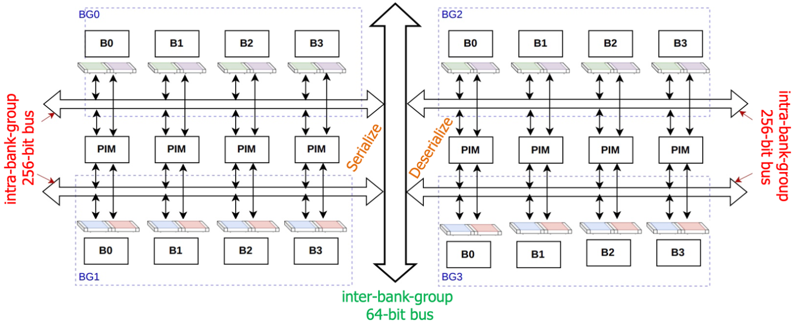
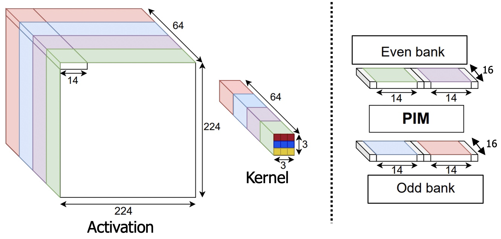
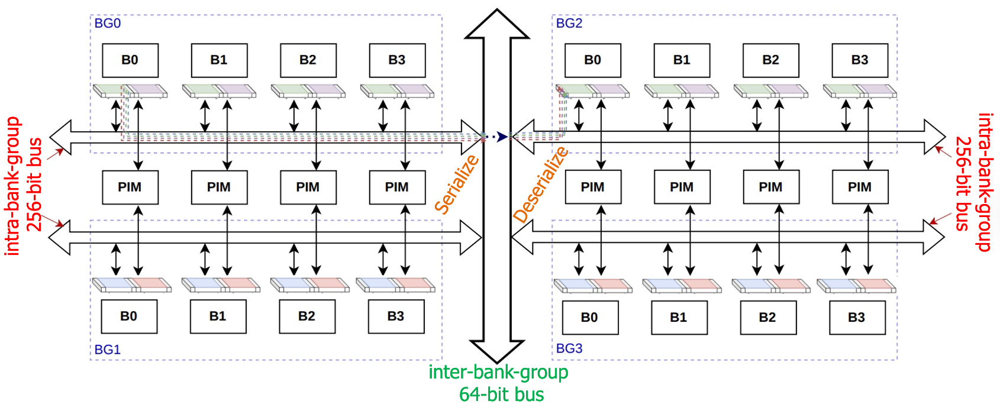
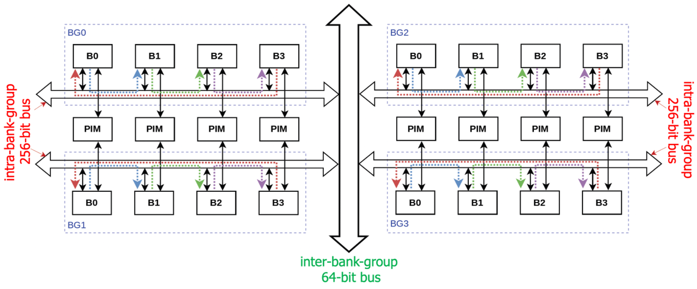

# Distributed Convolution and Network-on-Memory for Aquabolt-XL

## Acknowledgement and project context

This work extends Samsung's [Aquabolt-XL PIM Simulator](https://github.com/SAITPublic/PIMSimulator). Credit for the original simulator, architecture, ISA, and benchmarks belongs to Samsung and the original authors. The upstream simulator builds on DRAMSim2. See [README_original.md](README_original.md) for the original architecture and programming documentation; architectural descriptions there may differ from this research version.

These research extensions were developed at the **High-Performance Low-Power (HPLP) Laboratory, University of Virginia**, under Prof. Mircea Stan, as part of the **GPU-PIM Co-design project funded by the Laboratory for Physical Sciences (LPS) and Booz Allen Hamilton**. They are not part of Samsung's original release.

## Implementation status

> **Research prototype:** The performance simulator implements single-layer distributed convolution, including halo fill, partial-result computation, alignment, and final accumulation, with and without NoM. The functional simulator is not currently operational with these extensions, and numerical correctness has not been fully validated through functional simulation. Compatibility with the original Aquabolt-XL benchmarks has not been tested after the substantial architectural changes.
>
> ReLU functionality exists, but complete multi-layer CNN blocks and max pooling are not integrated. Timing results should be interpreted within the modeling assumptions below, rather than as evidence of functional correctness.

## Overview

Aquabolt-XL is an HBM-based, bank-level Processing-in-Memory (PIM) architecture. PIM units execute microcode held in a Control Register File (CRF), with execution driven through memory commands.

This extension explores **activation-stationary distributed convolution** instead of lowering convolution to GEMM. Activations are partitioned across banks, local PIM arithmetic computes partial results, and a proposed **Network-on-Memory (NoM)** supports exchanges between partitions. The objective is to reduce activation replication, data rearrangement, and intermediate transfers through the memory controller.

The data placement is intended to support consecutive convolution layers with limited rearrangement. This repository currently implements only the single-layer execution path; it does not demonstrate complete CNN block execution.

## Architectural extensions

### Register files and ISA

Each PIM unit has 16 entries in each of `GRF_A`, `GRF_B`, and the newly added `GRF_C`. Each vector entry holds a 256-bit burst, or 16 FP16 elements.

The main instruction and control extensions are:

- **Four nested `JUMP` levels:** Instructions explicitly select one of four loop-counter slots. Each slot records the associated jump's CRF address and remaining backward branches. A taken jump decrements its counter; completion reloads the programmed count for reuse. Entering PIM execution resets the slots to `-1`. These are explicitly managed counters, not an implicit loop stack.
- **`MACX`:** A specialized multiply-accumulate uses a selected jump counter's remaining count for operand indirection. If that count is uninitialized, it uses `2 * src1Idx - 1`. The `GRF_A` source index is the encoded source offset plus this count, wrapped to 16 entries. The destination index parameter is the count modulo `src1Idx`; in the convolution's auto-indexed `GRF_B` path, the actual register index is `(column - index_parameter + 1) mod 16`. The other source is the selected even/odd bank. Thus operand selection depends on both loop state and the triggering memory command.
- **`REDUCE`:** A local register reduction using transposed register-file accesses. For each source register, its 16 FP16 lanes are summed and accumulated into one selected lane of the corresponding destination register. The destination lane is selected by a jump-counter slot, defaulting to lane 15 before initialization. Convolution uses this to accumulate `GRF_B` reductions into `GRF_C`. It is not an inter-PIM network reduction.

The implementation also changes instruction encoding/decoding, register addressing, and execution control. See [PIMCmd.h](src/PIMCmd.h), [PIMCmd.cpp](src/PIMCmd.cpp), and [PIMRank.cpp](src/PIMRank.cpp). Generated convolution microcode is in [PIMCmdGen.h](src/tests/PIMCmdGen.h).

### Bank/PIM organization

Each simulated pseudo-channel contains four bank groups, four banks per group, and eight PIM units. Each PIM unit is associated with two banks in different bank groups:

| PIM unit | First bank | Second bank |
|---|---|---|
| 0–3 | BG0, local bank 0–3 | BG1, corresponding local bank |
| 4–7 | BG2, local bank 0–3 | BG3, corresponding local bank |

The mapping is implemented by `bankId()` and `pimblockID()` in [Configuration.h](src/Configuration.h). Even/odd bank selection in this version follows **bank-group parity**.

## Network-on-Memory

The proposed physical organization has **four 256-bit intra-bank-group buses**, one per bank group, and a **shared 64-bit inter-bank-group bus**. The intra-BG buses allow independent communication across the four groups; the narrower shared inter-BG resource would require serialization.

The current code implements specific communication operations:

| Operation | Implemented communication |
|---|---|
| `NOM1` | Directional copies between corresponding banks in BG0/BG2 and BG1/BG3, with source/destination column selection; used for halo fill. |
| `NOM2` | Left or right cyclic rotation of bank contents within each BG, applied across all four BGs; used for partial-result alignment. |

These operations are implemented in `PIMRank::doNOM()`. They are scheduled through CRF microcode and memory transactions, with barriers and mode changes in the convolution driver. NoM handles exchanges within a simulated channel; transfers crossing channel boundaries still use explicit memory reads and writes.

**Timing-model boundary:** The 256-bit and 64-bit widths describe the proposed architecture. The current implementation does not explicitly model separate buses with width-dependent transfer latency, arbitration, or contention. NoM commands execute through the simulator's existing command path. Results therefore evaluate the implemented command schedule, rather than a fully modeled physical NoM interconnect.



*Proposed NoM organization within one pseudo-channel. Each PIM connects corresponding banks in adjacent BG pairs. Bus widths and serialization/deserialization depict the architectural proposal; their separate latency and contention are not explicitly modeled, as described above.*

## Distributed convolution



*Example activation placement for a 3×3 convolution. The 64 input channels are divided into 16-channel slices across the paired banks; 14-element interior tiles leave space for halo values. “Even” and “odd” refer to bank-group parity in this version.*

The execution path in [PIMKernel.cpp](src/tests/PIMKernel.cpp) has four phases:

1. **Halo fill:** Make neighboring activation boundaries available to each partition. Without NoM, the driver queues explicit read/write transfers. With NoM, `NOM1` handles intra-channel exchanges, while channel-boundary exchanges remain explicit transfers.
2. **Partial-result computation:** Broadcast weights and execute local convolution microcode using `MACX`, nested jumps, and local `REDUCE` operations. Partial results are staged through register files and stored in banks.
3. **Partial-result alignment:** Move boundary partial results to the locations required for accumulation. The NoM path uses `NOM2` bank rotations plus explicit channel-boundary transfers; the comparison path uses explicit transfers throughout.
4. **Final accumulation:** PIM `FILL` and `ADD` sequences combine aligned contributions and write the final outputs back to banks.



*Halo fill through inter-BG copies (`NOM1`), illustrated by the colored paths between BG0 and BG2; the operation also supports corresponding transfers between BG1 and BG3. This uses the proposed shared 64-bit inter-BG bus, whereas alignment below uses the intra-BG buses. Channel-boundary halo transfers remain explicit memory reads and writes; bus-width-dependent timing is not explicitly modeled.*



*Partial-result alignment through intra-BG bank rotations (`NOM2`), illustrated by the colored paths. The driver also issues explicit transfers at channel boundaries, which are outside this single-pseudo-channel view.*

The current kernel is specialized around a **3×3 convolution** and its bank layout. It contains fixed three-row loops, 14-entry interior tiles, width tiling in units of 28, and output-channel iteration in groups of 64. Environment variables expose dimensions, but do not imply support for arbitrary shapes or kernel sizes. Use the supplied sweep configurations as the documented experiment set.

## Building and running

Run all commands below from **`PIMSimulator-NoM`**, not the enclosing gem5 repository:

```bash
cd PIMSimulator-NoM
```

### Environment and build

Use Linux with a C++17 compiler, Conda, SCons, GoogleTest, and pthreads. The supplied environment is a Linux-specific export with pinned package builds and a developer-specific `prefix`; it is not a portable macOS environment specification. Create it with an explicit environment name:

```bash
conda env create --name pimsim -f conda_env.yml
conda activate pimsim
scons NO_STORAGE=1
```

The build produces `./sim` and, by default, simulator libraries under `libdramsim/`. `NO_STORAGE=1` selects the no-data performance mode; it does not validate numerical outputs. The build reads GoogleTest include/library paths from `CONDA_PREFIX` and defaults to 32 parallel jobs. `NO_LIBRARY=1` can be added when only the executable is needed.

The functional/data-mode build described in the original documentation is not a supported validation path for these extensions at present.

### Single convolution benchmark

Run the default workload (64 input channels, 224×224 spatial dimensions, 3×3 kernel, 64 output channels) with NoM:

```bash
PIM_CONV_D=64 PIM_CONV_H=224 PIM_CONV_W=224 PIM_CONV_NOM=1 \
  ./sim --gtest_filter=PIMBenchFixture.conv
```

Run the same distributed convolution without NoM:

```bash
env -u PIM_CONV_NOM PIM_CONV_D=64 PIM_CONV_H=224 PIM_CONV_W=224 \
  ./sim --gtest_filter=PIMBenchFixture.conv
```

**`PIM_CONV_NOM` is a presence flag:** setting it to `0` also enables NoM. Unset it to disable NoM.

| Variable | Default | Meaning |
|---|---|---|
| `PIM_CONV_D` | 64 | Input depth |
| `PIM_CONV_H` | 224 | Input height |
| `PIM_CONV_W` | 224 | Input width |
| `PIM_CONV_K` | 3 | Kernel-size parameter; retain 3 for the implemented kernel |
| `PIM_CONV_COUT` | Input depth | Output-channel count; retain the supplied experiment values |
| `PIM_CONV_NOM` | Unset | Enable NoM when present |

The benchmark uses [system_hbm_64ch.ini](system_hbm_64ch.ini), including its `NUM_CHANS` setting. These simulated channels correspond to the simulator's independently controlled pseudo-channels. The kernel checks several layout constraints, including positive width divisible by 28, working-channel count divisible by `width / 28`, and compatible per-PIM allocation. These checks do not establish general shape support.

The performance benchmark constructs its workload from dimensions; generating reference `.npy` files is not required for this path. The existing data generator and `KernelTest` path concern functional testing, which remains incomplete.

To inspect available benchmark names:

```bash
./sim --gtest_list_tests
```

Legacy performance filters include `PIMBenchFixture.gemv`, `.mul`, `.add`, and `.relu`. Their continued presence does not establish compatibility with the modified architecture; avoid treating an unfiltered full-suite run as a validated workflow.

## Performance experiments

### Run the supplied sweep

Build the performance executable first, then run on Linux with GNU `sed`:

```bash
env -u PIM_CONV_NOM bash run_conv_pimbench_sweep.sh
```

The script runs each configuration twice, without and with NoM:

| Input depth × height × width | Simulated channels |
|---|---|
| 64 × 448 × 448 | 64 |
| 64 × 224 × 224 | 64 |
| 128 × 224 × 224 | 64 |
| 128 × 112 × 112 | 16 |
| 256 × 112 × 112 | 16 |
| 256 × 56 × 56 | 4 |
| 512 × 56 × 56 | 4 |

It temporarily edits `NUM_CHANS` in `system_hbm_64ch.ini` and restores the file through an exit trap. Do not run concurrent sweeps against the same configuration file. It logs full console output to `logs/pimbench_conv_sweep_<UTC timestamp>.log` and records each case's exit status. By default, it continues after a failed case.

Optional settings include `LOG_DIR`, `LOG`, `STOP_ON_ERROR=1`, and `REBUILD=1`. For example:

```bash
env -u PIM_CONV_NOM STOP_ON_ERROR=1 REBUILD=1 \
  BUILD_CMD='scons NO_STORAGE=1' bash run_conv_pimbench_sweep.sh
```

Use the explicit performance build command when requesting a rebuild: the script's default `BUILD_CMD` is plain `scons`. Also unset inherited `PIM_CONV_K` and `PIM_CONV_COUT`, or leave them at the documented defaults, to reproduce the supplied experiment set.

### Collect and interpret results

For each invocation, the benchmark prints cycles for PIM disabled, cycles for PIM enabled, and a `Speed-up` ratio. To inspect the relevant lines in a saved log:

```bash
rg 'Finished|PIM enabled|PIM disabled|Cycle :|Speed-up' logs/pimbench_conv_sweep_*.log
```

For a direct NoM comparison, pair the **PIM-enabled cycle counts** for the same shape and channel count. The ratio `cycles_without_NoM / cycles_with_NoM` measures the modeled improvement from NoM under this implementation.

The benchmark's printed `Speed-up` instead divides its non-PIM cycle count by its PIM cycle count. **The non-PIM convolution path remains a memory-traffic baseline with an explicit implementation TODO; it is not a complete CPU/GPU convolution execution model.** The test also asserts that this ratio exceeds 2×, so a failed test may reflect that threshold rather than a simulator execution failure. Inspect logs and exit statuses before using results.

## Current scope and future work

The current scope is single-layer distributed convolution performance modeling. ReLU support already exists, but has not been integrated into a complete sequence such as:

```text
Conv → ReLU → Conv → ReLU → MaxPool
```

Future work includes functional validation, testing the original benchmarks after the architectural changes, max pooling, consecutive-layer integration, and evaluating intermediate placement across complete CNN blocks. More detailed NoM bandwidth/contention modeling and broader convolution configurations are possible extensions; neither is claimed as complete here.

## Authors and licensing

**Kavish Ranawella and Ersin Cukurtas**
High-Performance Low-Power (HPLP) Laboratory
Department of Electrical and Computer Engineering
University of Virginia

The existing [Samsung PIMSimulator license](LICENSE-PIMSimulator) and [DRAMSim2 license](LICENSE-DRAMSIM2) remain applicable to their respective code. The Samsung license restricts use to non-commercial, personal or academic research purposes; consult the license text for its terms. Original copyright notices and [upstream documentation](README_original.md) are retained.
